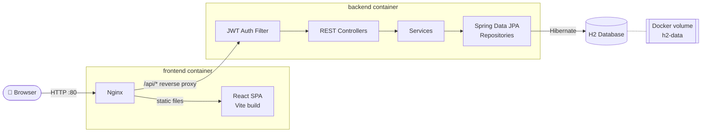
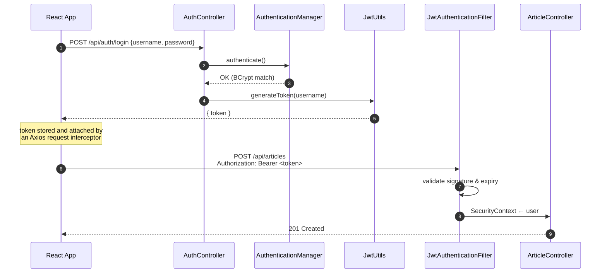
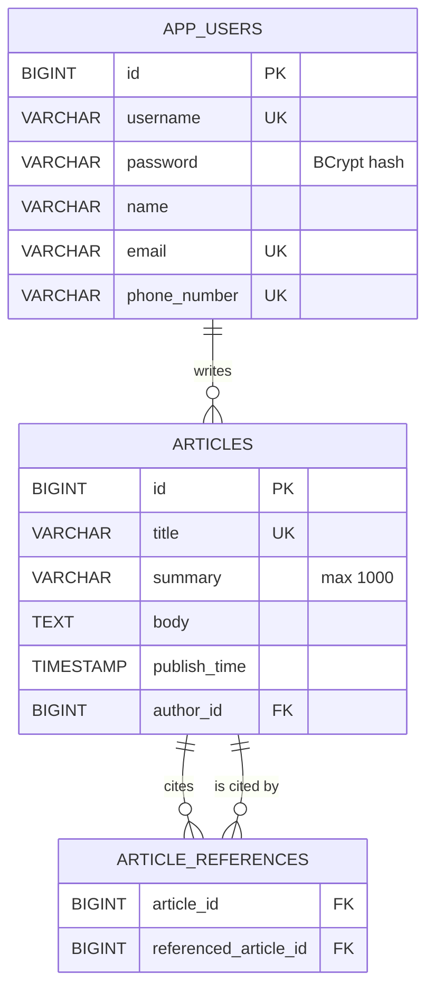

<div align="center">



<br/>

[](https://github.com/behradbina/webresource/actions/workflows/ci.yml)


**A full-stack platform for publishing articles that cite each other.**
Spring Boot REST API with stateless JWT auth · React SPA · fully containerised with Docker & Nginx.

[Features](#-features) · [Architecture](#-architecture) · [Quick Start](#-quick-start) · [API](#-rest-api) · [Data Model](#-data-model) · [What I Learned](#-what-i-learned)

</div>

---

## 📸 Preview

<!--
  Add screenshots / a GIF of the running app here, e.g.:

  <p align="center">
    
  </p>

  <table>
    <tr>
      <td></td>
      <td></td>
    </tr>
    <tr>
      <td align="center"><b>Browse, search & sort</b></td>
      <td align="center"><b>Article with references & citations</b></td>
    </tr>
  </table>
-->

> _Screenshots and a demo GIF go here. See [`docs/screenshots/README.md`](docs/screenshots/README.md)._

---

## ✨ Features

| | Feature | Details |
|---|---|---|
| 🔐 | **Authentication** | Register / login with **JWT (HS256)**, **BCrypt**-hashed passwords, stateless sessions |
| 🛡️ | **Authorization** | Public reads; creating requires login; **only the author can delete** their article (`401` / `403` handled) |
| 📝 | **Article CRUD** | Create, view and delete articles with title, summary and body |
| 🔗 | **Citation graph** | Articles reference other articles (self-referencing **many-to-many**); each article shows who cites it |
| 🔎 | **Search & sort** | Case-insensitive search on title/summary; sort by **popularity (citations)** or **date** |
| 👤 | **User profile** | View/update profile and change password, with server-side validation (email, phone, password strength) |
| ⚡ | **Responsive UX** | Request cancellation with `AbortController`, toast notifications, protected routes, 404 page |
| 🐳 | **One-command deploy** | Multi-stage Docker builds, Nginx serving the SPA and reverse-proxying `/api`, persistent volume |

---

## 🏗 Architecture



### Authentication flow



---

## 🧰 Tech Stack

<table>
<tr>
<td valign="top" width="33%">

**Backend**
- Java 21
- Spring Boot 3.4
- Spring Web (REST)
- Spring Security 6
- JJWT 0.11
- Spring Data JPA / Hibernate
- H2 (file-based)
- Maven

</td>
<td valign="top" width="33%">

**Frontend**
- React 19
- Vite 8
- React Router 7 (data router)
- Context API for auth state
- Axios + interceptors
- React Toastify
- ESLint

</td>
<td valign="top" width="33%">

**DevOps**
- Docker (multi-stage builds)
- Docker Compose
- Nginx (SPA + reverse proxy)
- Named volumes for persistence
- GitHub Actions CI

</td>
</tr>
</table>

---

## 🚀 Quick Start

### Option A — Docker (recommended)

```bash
git clone https://github.com/behradbina/webresource.git
cd webresource
cp .env.example .env          # set your own JWT_SECRET
docker compose up --build
```

| Service | URL |
|---|---|
| App (Nginx + React) | http://localhost |
| REST API | http://localhost:8080/api |

Stop with `docker compose down` (add `-v` to also wipe the database volume).

### Option B — Run locally

**Requirements:** Java 21+, Node.js 18+, npm

```bash
# Terminal 1 — backend (http://localhost:8080)
cd backend
./mvnw spring-boot:run          # Windows: mvnw.cmd spring-boot:run

# Terminal 2 — frontend (http://localhost:5173)
cd frontend
npm install
npm run dev
```

#### H2 console

Browse the database at **http://localhost:8080/h2-console**

| Setting | Value |
|---|---|
| JDBC URL | `jdbc:h2:file:./data/articles_db` (local) · `jdbc:h2:file:/app/data/articles_db` (Docker) |
| Username | `sa` |
| Password | _(empty)_ |

### Configuration

| Variable | Default | Purpose |
|---|---|---|
| `JWT_SECRET` | dev-only fallback | HS256 signing key (≥ 32 chars) |
| `JWT_EXPIRATION_MS` | `86400000` (24h) | Token lifetime |
| `SPRING_PROFILES_ACTIVE` | — | `production` inside Docker |

---

## 📡 REST API

Base URL: `http://localhost:8080/api`  ·  🔓 public  ·  🔒 requires `Authorization: Bearer <token>`

### Auth

| Method | Endpoint | | Description |
|---|---|---|---|
| `POST` | `/auth/register` | 🔓 | Create an account (`username`, `password`, `name`, `email` and/or `phoneNumber`) |
| `POST` | `/auth/login` | 🔓 | Returns `{ "token": "<jwt>" }` |

### Articles

| Method | Endpoint | | Description |
|---|---|---|---|
| `GET` | `/articles?q=&sort=refs\|date` | 🔓 | List, search and sort articles |
| `GET` | `/articles/{title}` | 🔓 | Get one article |
| `GET` | `/articles/{title}/referrers` | 🔓 | Articles that cite this one |
| `POST` | `/articles` | 🔒 | Create an article (`409` duplicate title, `422` self-reference) |
| `DELETE` | `/articles/{title}` | 🔒 | Delete (author only, otherwise `403`) |

### Users

| Method | Endpoint | | Description |
|---|---|---|---|
| `GET` | `/users/me` | 🔒 | Current user's profile |
| `PUT` | `/users/me/update` | 🔒 | Update name / email / phone |
| `PUT` | `/users/me/change-password` | 🔒 | Change password (verifies the old one) |

<details>
<summary><b>📋 Example session with curl</b></summary>

```bash
# 1. Register
curl -X POST http://localhost:8080/api/auth/register \
  -H "Content-Type: application/json" \
  -d '{"username":"alice","password":"Secret123","name":"Alice","email":"alice@example.com"}'

# 2. Login and keep the token
TOKEN=$(curl -s -X POST http://localhost:8080/api/auth/login \
  -H "Content-Type: application/json" \
  -d '{"username":"alice","password":"Secret123"}' | sed -E 's/.*"token":"([^"]+)".*/\1/')

# 3. Create articles (the second one cites the first)
curl -X POST http://localhost:8080/api/articles \
  -H "Authorization: Bearer $TOKEN" -H "Content-Type: application/json" \
  -d '{"title":"Java","summary":"Java basics","body":"Introduction to Java","refs":[]}'

curl -X POST http://localhost:8080/api/articles \
  -H "Authorization: Bearer $TOKEN" -H "Content-Type: application/json" \
  -d '{"title":"Spring","summary":"Spring Framework","body":"Spring Boot content","refs":["Java"]}'

# 4. Read (no token needed)
curl "http://localhost:8080/api/articles?q=java&sort=date"
curl http://localhost:8080/api/articles/Java/referrers

# 5. Delete your own article
curl -X DELETE http://localhost:8080/api/articles/Spring -H "Authorization: Bearer $TOKEN"
```

</details>

---

## 🗄 Data Model



- **`article_references`** is a join table generated by Hibernate from a **self-referencing `@ManyToMany`**: one article can cite many articles and be cited by many.
- The citation count shown in the UI (and used for "popular" sorting) is the number of rows pointing **to** an article.
- Schema is managed by Hibernate (`ddl-auto=update`), and data is persisted to disk (or to a Docker volume).

---

## 📁 Project Structure

```text
webresource/
├── backend/                         # Spring Boot REST API
│   ├── src/main/java/.../webresource/
│   │   ├── config/                  # SecurityConfig, JwtUtils, JwtAuthenticationFilter
│   │   ├── controller/              # Auth, Article, User controllers
│   │   ├── dto/                     # Request / response objects
│   │   ├── model/                   # JPA entities (User, Article)
│   │   ├── repository/              # Spring Data repositories
│   │   └── service/                 # Business logic & validation
│   └── Dockerfile                   # Maven build → slim JRE image
├── frontend/                        # React + Vite SPA
│   ├── src/
│   │   ├── api/                     # Axios client + JWT interceptor
│   │   ├── components/              # Navbar, ArticleCard, SearchBar, ProtectedRoute…
│   │   ├── context/                 # AuthContext
│   │   └── pages/                   # Home, Article, Create, Login, Register, Profile
│   ├── nginx.conf                   # SPA fallback + /api reverse proxy
│   └── Dockerfile                   # Node build → Nginx image
├── docker-compose.yml
└── .github/workflows/ci.yml         # Build & test on every push
```

---

## 🎓 What I Learned

**Backend**
- Designing a layered **Controller → Service → Repository** REST API with DTOs, and returning proper status codes (`201`, `401`, `403`, `404`, `409`, `422`).
- Securing an API with **Spring Security** and a custom **JWT filter**: stateless sessions, BCrypt hashing, per-route rules and resource-ownership checks.
- Modelling a **self-referencing many-to-many** relationship and a one-to-many author relation with **JPA/Hibernate**, and writing derived and custom repository queries.
- Configuring **CORS**, Spring profiles, and secrets from environment variables.

**Frontend**
- Building an SPA with **React 19** and **React Router 7**, including protected routes.
- Managing auth state with the **Context API** and attaching tokens through an **Axios interceptor**.
- Avoiding race conditions in search with **`AbortController`**, and giving clear feedback with toast notifications.

**DevOps**
- Writing **multi-stage Dockerfiles** for both a JVM and a Node app, and orchestrating them with **Docker Compose**.
- Using **Nginx** as a static server and reverse proxy so the browser talks to a single origin.
- Setting up **CI with GitHub Actions** to build, test and build images automatically.

---

## 🛣 Roadmap

- [ ] PostgreSQL profile for production (driver already included)
- [ ] Pagination for the article list
- [ ] Integration tests for controllers with MockMvc
- [ ] OpenAPI / Swagger UI documentation
- [ ] Edit articles and visualise the citation graph

---

## 📝 Notes

- Article titles are unique and act as the public identifier in URLs.
- An article cannot reference itself.
- Data persists across restarts (H2 file database / Docker volume).

---

<div align="center">

Built for the **Internet Engineering** course at the **University of Tehran**.

Licensed under the [MIT License](LICENSE).

⭐ If you found this useful, consider giving it a star!

</div>
